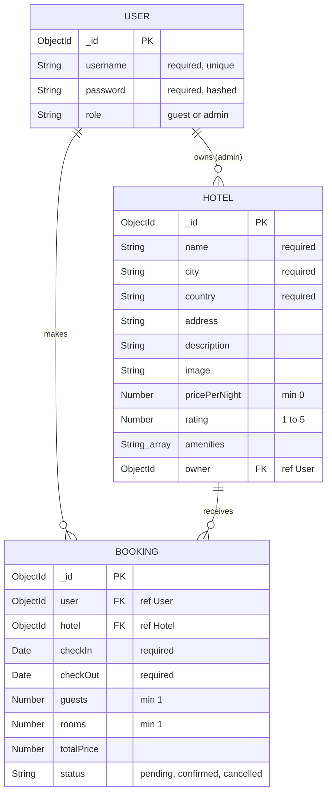

# Project Name

## Overview

## Screenshots

## Technologies Used

- Node.js
- Express
- MongoDB & Mongoose
- EJS
- express-session & connect-mongo
- bcrypt
- method-override
- morgan
- dotenv

## Getting Started

## User Stories

### Guest (not signed in)
- As a guest, I want to browse all hotels so that I can see what places are available.
- As a guest, I want to view a hotel's details (location, price per night, amenities, rating) so that I can decide if I want to stay there.
- As a guest, I want to sign up for an account so that I can book a hotel.

### User (signed in)
- As a user, I want to sign in and sign out so that my bookings stay private to my account.
- As a user, I want to book a hotel by choosing check-in and check-out dates, number of guests and rooms so that I can reserve my stay.
- As a user, I want to see the total price before I confirm so that I know how much my stay will cost.
- As a user, I want to see a list of all my bookings so that I can keep track of my trips.
- As a user, I want to view the details of one booking so that I can check my dates and price.
- As a user, I want to edit a booking (dates, guests, rooms) so that I can change my plans.
- As a user, I want to cancel a booking so that I can remove a trip I no longer want.
- As a user, I should not be able to see, edit or cancel someone else's bookings.

### Admin (optional)
- As an admin, I want to add, edit and delete hotels so that the hotel list stays up to date.

## Database Design

- A **User** can have many **Bookings**.
- A **Hotel** can have many **Bookings**.
- A **Booking** belongs to one User and one Hotel.
- A **User** with the admin role can own many **Hotels** (optional).

## Routes

| Method | Route | Description |
|---------|-------|-------------|
| GET | / | Home page |
| GET | /auth/sign-up | Sign up form |
| POST | /auth/sign-up | Create account |
| GET | /auth/sign-in | Sign in form |
| POST | /auth/sign-in | Sign in |
| GET | /auth/sign-out | Sign out |
| GET | /hotels | List all hotels |
| GET | /hotels/:id | View hotel |
| GET | /bookings | List my bookings |
| GET | /bookings/new | New booking form |
| POST | /bookings | Create booking |
| GET | /bookings/:id | View booking |
| GET | /bookings/:id/edit | Edit booking form |
| PUT | /bookings/:id | Update booking |
| DELETE | /bookings/:id | Cancel (delete) booking |

## Features

## Future Enhancements

## Credits
